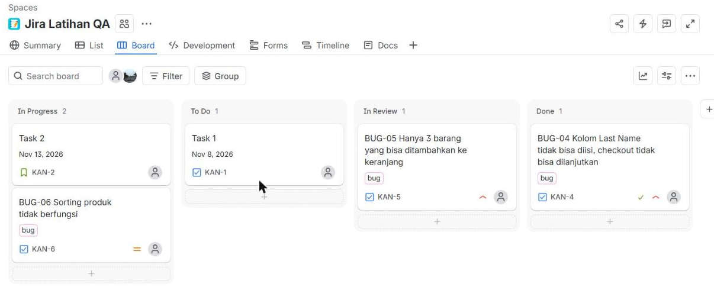

# QA Portfolio – Muhammad Arif Billah Natagama

Mahasiswa Teknik Informatika (semester 7) yang sedang fokus belajar **Quality Assurance (QA)**. Berlatar belakang UI/UX dan dasar Cyber Security, sehingga saya terbiasa memperhatikan sisi **usability** dan **keamanan** saat menguji aplikasi.

📫 Kontak: gama82059@gmail.com · [LinkedIn](https://www.linkedin.com/in/muhammad-arif-billah-natagama-8b7125315)

---

## 📁 Daftar Project

| # | Project | Jenis Testing | Status |
|---|---------|---------------|--------|
| 1 | [Pengujian Fitur Login – SauceDemo](#project-1-pengujian-fitur-login-saucedemo) | Manual, Functional, Negative | ✅ Selesai |
| 2 | [Pengujian Alur Belanja (cart → checkout) – SauceDemo](#project-2-pengujian-alur-belanja-saucedemo-akun-problem_user) | Manual, Functional, Exploratory | ✅ Selesai |
| 3 | Pengujian API – Postman (Restful-Booker) | API Testing | ⏳ Rencana |
| 4 | Otomasi Test Login – Playwright | Automation | ⏳ Rencana |

---

## Project 1: Pengujian Fitur Login (SauceDemo)

**Aplikasi yang diuji:** https://www.saucedemo.com (situs demo untuk latihan testing)
**Jenis pengujian:** Manual functional testing (skenario positif dan negatif)
**Teknik yang dipakai:** Equivalence Partitioning, Boundary Value Analysis, Error Guessing

### Ruang Lingkup
Fitur login: username/password valid, salah, kosong, case-sensitive, format email, akun terkunci (`locked_out_user`), akses langsung ke halaman tanpa login, dan percobaan login berulang.

### Hasil
- **12 test case**: 9 Pass, 2 Fail, 1 N/A (fitur tidak tersedia)
- **3 bug** dan **3 observasi** ditemukan

| ID | Temuan | Severity |
|----|--------|----------|
| BUG-01 | Tidak ada pembatasan percobaan login (tanpa lockout/CAPTCHA/penundaan) | Medium |
| BUG-02 | Saat username dan password kosong, hanya pesan username yang muncul | Low |
| BUG-03 | Pesan error yang panjang terpotong di kotak merah | Low |
| OBS-01 | Pesan locked out membedakan akun terkunci dari kredensial salah (potensi user enumeration) | Low |
| OBS-02 | Pesan error tidak memberi petunjuk bahwa login memakai username, bukan email | Low |
| OBS-03 | Tidak ada fitur show/hide password, sehingga pengguna sulit memastikan password yang diketik | Low |

### Dokumen
- 📊 Test case & ringkasan temuan: [Google Sheet](https://docs.google.com/spreadsheets/d/1tOBTeLUC1jbGIvGAtP3jhZNwbULxlmorf8ABgktQv4Q/edit?usp=sharing)
- 🐞 Bug report: [`bug-reports.md`](bug-reports.md) (BUG-01 sampai BUG-03)
- 📚 Catatan belajar: [Bug Lifecycle dan STLC](catatan/bug-lifecycle-stlc.md)

### Yang Saya Pelajari
- Menulis test case yang bisa diulang orang lain (ID, prasyarat, data uji, langkah, hasil diharapkan)
- Membedakan **severity** dan **priority**
- Menilai temuan dari sisi usability (UI/UX) dan keamanan (brute force, user enumeration)

---

## Project 2: Pengujian Alur Belanja (SauceDemo, akun problem_user)

**Aplikasi yang diuji:** https://www.saucedemo.com
**Akun uji:** `problem_user` (akun demo yang memang sengaja bermasalah)
**Jenis pengujian:** Manual functional testing dan exploratory testing
**Teknik yang dipakai:** Exploratory testing, Equivalence Partitioning, Boundary Value Analysis

### Ruang Lingkup
Halaman produk (tampilan, sorting, tambah/hapus barang), keranjang, dan checkout (isi data, validasi, ringkasan pesanan, selesai).

### Hasil
- **27 test case**: 22 Pass, 3 Fail, 2 perlu dicek ulang
- **5 bug** dan **3 observasi** ditemukan

| ID | Temuan | Severity |
|----|--------|----------|
| BUG-04 | Kolom Last Name tidak bisa diisi, checkout tidak bisa dilanjutkan | High |
| BUG-05 | Hanya 3 barang yang bisa ditambahkan ke keranjang | High |
| BUG-06 | Sorting produk tidak berfungsi | Medium |
| BUG-07 | Tombol Remove di halaman produk tidak berfungsi | Medium |
| BUG-08 | Semua produk menampilkan foto yang salah | Medium |

### Pelacakan Bug di Jira
Bug dicatat sebagai issue di Jira dan statusnya digeser mengikuti bug lifecycle (To Do → In Progress → In Review → Done).

### Dokumen
- 📊 Test case & ringkasan temuan: [Google Sheet](https://docs.google.com/spreadsheets/d/1tOBTeLUC1jbGIvGAtP3jhZNwbULxlmorf8ABgktQv4Q/edit?usp=sharing) (tab *Test Case Produk dan Checkout* dan *Ringkasan Temuan*)
- 🐞 Bug report: [`bug-reports-project-2.md`](bug-reports-project-2.md) (BUG-04 sampai BUG-08, lengkap dengan screenshot)

### Yang Saya Pelajari
- Exploratory testing, lalu mengubah catatannya menjadi test case dan bug report yang rapi
- Menulis langkah reproduksi, hasil aktual, dan hasil yang diharapkan secara jelas
- Mengelola bug di Jira dan memahami bug lifecycle secara langsung

---

## 🛠️ Tools & Skill
Test case design · Bug reporting · Postman · SQL dasar · Git/GitHub · Playwright (belajar) · Jira (dasar)
