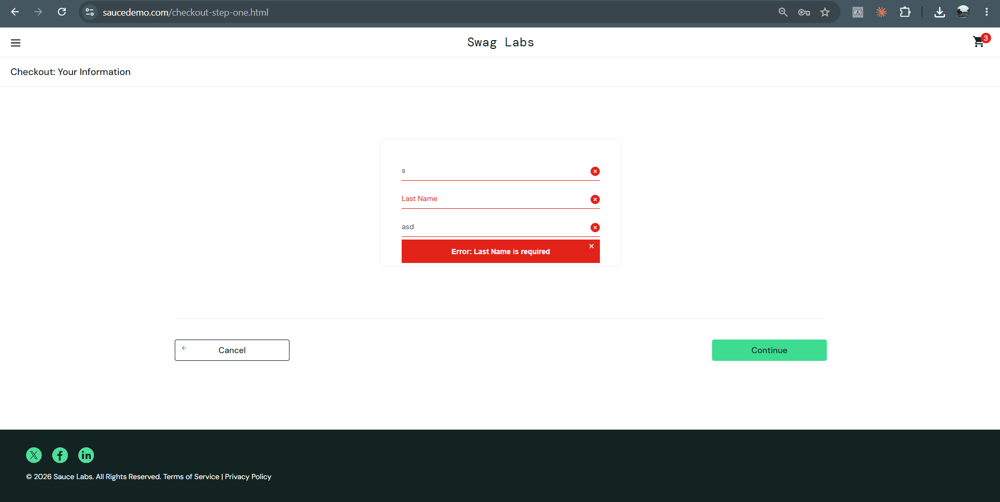
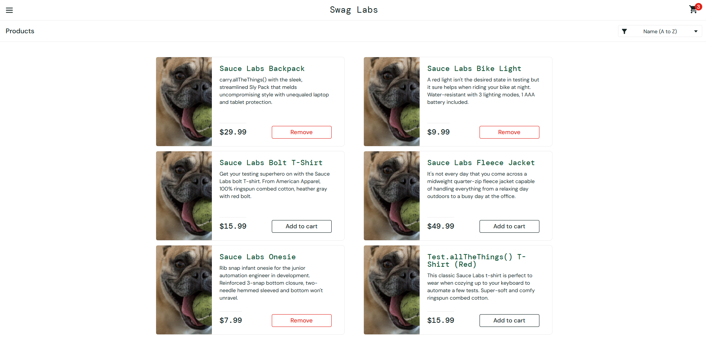
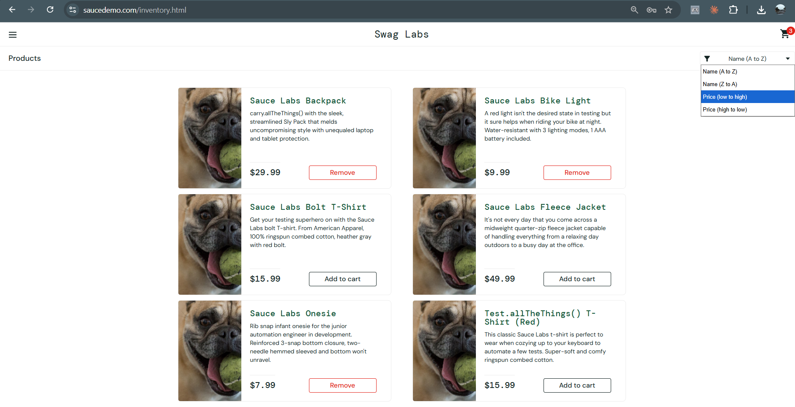
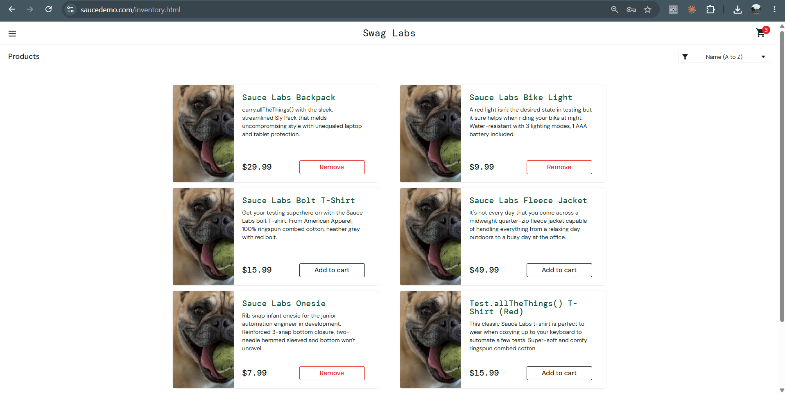

# Bug Reports – Pengujian Alur Belanja SauceDemo (akun problem_user)

**Aplikasi:** SauceDemo (https://www.saucedemo.com), situs demo untuk latihan testing
**Penguji:** Muhammad Arif Billah Natagama
**Akun uji:** `problem_user` / `secret_sauce` (akun demo yang memang sengaja bermasalah)
**Environment:** Chrome, Windows 11, 3 November 2026

| ID | Judul | Severity | Priority | Status |
|----|-------|----------|----------|--------|
| [BUG-04](#bug-04-kolom-last-name-tidak-bisa-diisi-checkout-tidak-bisa-dilanjutkan) | Kolom Last Name tidak bisa diisi, checkout tidak bisa dilanjutkan | High | High | Open |
| [BUG-05](#bug-05-hanya-3-barang-yang-bisa-ditambahkan-ke-keranjang) | Hanya 3 barang yang bisa ditambahkan ke keranjang | High | Medium | Open |
| [BUG-06](#bug-06-sorting-produk-tidak-berfungsi) | Sorting produk tidak berfungsi | Medium | Medium | Open |
| [BUG-07](#bug-07-tombol-remove-di-halaman-produk-tidak-berfungsi) | Tombol Remove di halaman produk tidak berfungsi | Medium | Medium | Open |
| [BUG-08](#bug-08-semua-produk-menampilkan-foto-yang-salah) | Semua produk menampilkan foto yang salah | Medium | Medium | Open |

> **Severity** = seberapa parah dampak bug. **Priority** = seberapa cepat bug perlu diperbaiki.
> Bug di dokumen ini berasal dari testing eksploratori dengan akun `problem_user` (lihat tab Test di Google Sheet). Bug dari Project 1 ada di [`bug-reports.md`](bug-reports.md).

---

## BUG-04: Kolom Last Name tidak bisa diisi, checkout tidak bisa dilanjutkan

| Field | Isi |
|-------|-----|
| **Severity / Priority** | High / High |
| **Status** | Open |

**Deskripsi**
Pada halaman *Checkout: Your Information*, kolom Last Name tidak menerima input. Karena kolom itu wajib diisi, pengguna tidak bisa menyelesaikan pembelian sama sekali.

**Langkah Reproduksi**
1. Buka https://www.saucedemo.com
2. Login dengan username `problem_user` dan password `secret_sauce`
3. Tambahkan satu barang ke keranjang, lalu buka keranjang
4. Klik **Checkout**
5. Isi kolom **First Name**, lalu coba isi kolom **Last Name**
6. Isi kolom **Postal Code**, lalu klik **Continue**

**Hasil Aktual**
Kolom Last Name tetap kosong. Muncul pesan *"Error: Last Name is required"* dan pengguna tidak bisa lanjut ke halaman ringkasan pesanan. Pada screenshot, kolom First Name hanya berisi satu huruf.

**Hasil yang Diharapkan**
Semua kolom bisa diisi, lalu klik Continue membawa pengguna ke halaman ringkasan pesanan.

**Dampak**
Pengguna tidak bisa menyelesaikan pembelian, sehingga alur utama aplikasi terblokir.

**Saran Perbaikan**
Periksa penanganan input pada kolom Last Name (kemungkinan input masuk ke kolom yang salah).

**Bukti:**

---

## BUG-05: Hanya 3 barang yang bisa ditambahkan ke keranjang

| Field | Isi |
|-------|-----|
| **Severity / Priority** | High / Medium |
| **Status** | Open |

**Deskripsi**
Tombol *Add to cart* pada sebagian produk tidak berfungsi, sehingga jumlah barang di keranjang tidak bisa lebih dari 3.

**Langkah Reproduksi**
1. Login dengan `problem_user` / `secret_sauce`
2. Pada halaman Products, klik **Add to cart** pada semua produk satu per satu
3. Perhatikan angka di ikon keranjang

**Hasil Aktual**
Hanya 3 barang yang masuk (angka keranjang berhenti di 3). Tombol Add to cart pada 3 produk lainnya tidak merespons.

**Hasil yang Diharapkan**
Semua produk bisa ditambahkan ke keranjang, dan angka keranjang bertambah sesuai jumlahnya.

**Dampak**
Pengguna tidak bisa membeli lebih dari 3 jenis barang dalam satu pesanan.

**Saran Perbaikan**
Periksa fungsi klik pada tombol Add to cart untuk produk yang tidak merespons.

**Bukti:**

---

## BUG-06: Sorting produk tidak berfungsi

| Field | Isi |
|-------|-----|
| **Severity / Priority** | Medium / Medium |
| **Status** | Open |

**Deskripsi**
Memilih opsi pada dropdown sorting tidak mengubah urutan produk.

**Langkah Reproduksi**
1. Login dengan `problem_user` / `secret_sauce`
2. Klik dropdown sorting di pojok kanan atas halaman Products
3. Pilih **Price (low to high)**
4. Perhatikan urutan produk

**Hasil Aktual**
Urutan produk tidak berubah dan dropdown tetap menampilkan *Name (A to Z)*. Opsi sorting lainnya juga tidak memberi efek.

**Hasil yang Diharapkan**
Produk terurut dari harga termurah ke termahal.

**Dampak**
Pengguna tidak bisa mengurutkan produk untuk menemukan barang yang dicari.

**Saran Perbaikan**
Periksa penanganan perubahan nilai dropdown sorting.

**Bukti:**

---

## BUG-07: Tombol Remove di halaman produk tidak berfungsi

| Field | Isi |
|-------|-----|
| **Severity / Priority** | Medium / Medium |
| **Status** | Open |

**Deskripsi**
Tombol *Remove* pada kartu produk di halaman Products tidak menghapus barang dari keranjang. Barang hanya bisa dihapus lewat halaman keranjang.

**Langkah Reproduksi**
1. Login dengan `problem_user` / `secret_sauce`
2. Klik **Add to cart** pada salah satu produk (tombol berubah menjadi **Remove**)
3. Klik **Remove** pada kartu produk yang sama
4. Perhatikan tombol dan angka di ikon keranjang

**Hasil Aktual**
Tombol Remove tidak menghapus barang. Barang baru bisa dihapus setelah membuka halaman keranjang.

**Hasil yang Diharapkan**
Barang keluar dari keranjang dan angka keranjang berkurang.

**Dampak**
Perilaku tidak konsisten dan membingungkan pengguna.

**Saran Perbaikan**
Periksa fungsi klik pada tombol Remove di halaman Products.

**Bukti:** Tombol Remove pada barang yang sudah masuk keranjang terlihat di screenshot BUG-05. Rekaman layar saat tombol diklik belum tersedia.

---

## BUG-08: Semua produk menampilkan foto yang salah

| Field | Isi |
|-------|-----|
| **Severity / Priority** | Medium / Medium |
| **Status** | Open |

**Deskripsi**
Semua produk di halaman Products menampilkan foto yang sama, yaitu foto seekor anjing, bukan foto barang yang dijual. Foto di halaman detail produk berbeda dengan foto di daftar.

**Langkah Reproduksi**
1. Login dengan `problem_user` / `secret_sauce`
2. Perhatikan foto pada tiap produk di halaman Products
3. Klik salah satu produk untuk membuka halaman detail dan bandingkan fotonya

**Hasil Aktual**
Foto di daftar produk berupa gambar anjing yang sama untuk semua barang. Pada halaman detail, foto yang tampil berbeda.

**Hasil yang Diharapkan**
Foto di daftar sesuai dengan barangnya dan sama dengan foto di halaman detail.

**Dampak**
Pengguna tidak bisa melihat rupa barang yang akan dibeli, sehingga bisa salah pilih.

**Saran Perbaikan**
Periksa pemetaan gambar pada tiap produk.

**Bukti:**

