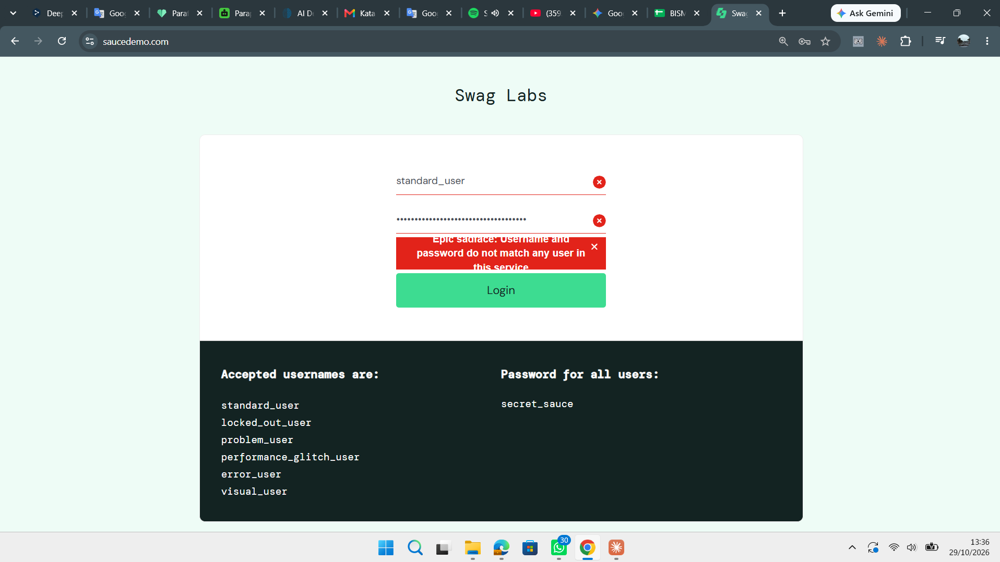
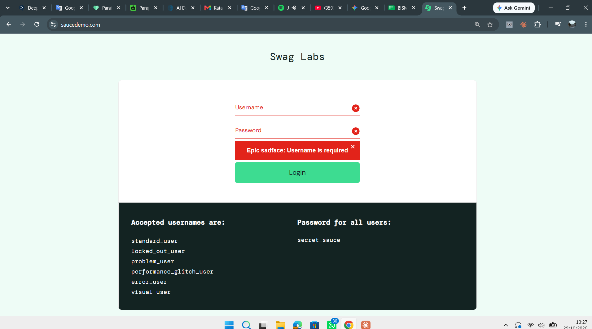
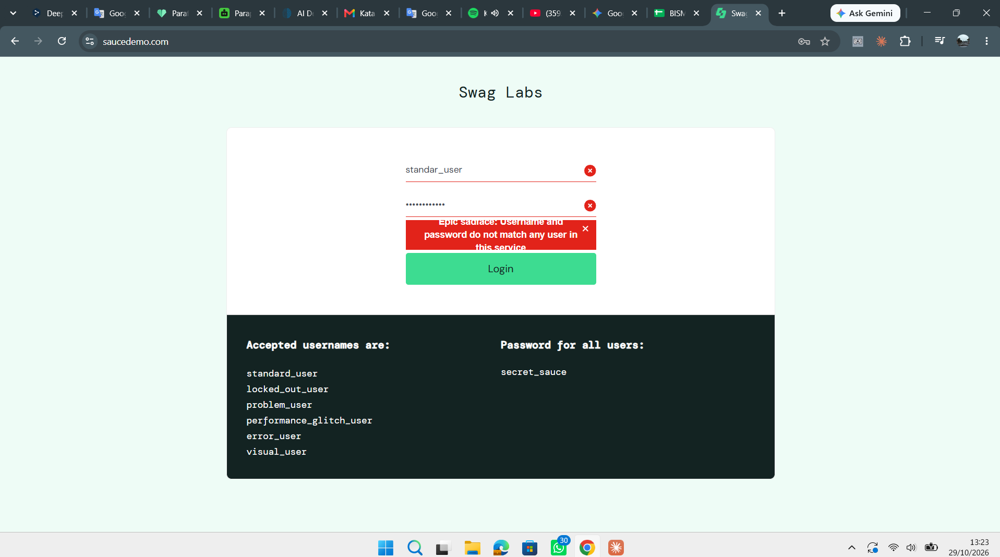

# Bug Reports – Pengujian Login SauceDemo

**Aplikasi:** SauceDemo (https://www.saucedemo.com), situs demo untuk latihan testing  
**Penguji:** Muhammad Arif Billah Natagama  
**Environment:** Chrome [isi versi], Windows [isi versi], [isi tanggal tes]

| ID | Judul | Test Case | Severity | Priority | Status |
|----|-------|-----------|----------|----------|--------|
| [BUG-01](#bug-01-login-tidak-dibatasi-setelah-banyak-percobaan-gagal) | Login tidak dibatasi setelah banyak percobaan gagal | TC_LOG_009 | Medium | Medium | Open |
| [BUG-02](#bug-02-pesan-validasi-password-tidak-muncul-saat-form-kosong-semua) | Pesan validasi password tidak muncul saat form kosong semua | TC_LOG_007 | Low | Low | Open |
| [BUG-03](#bug-03-pesan-error-panjang-terpotong-di-kotak-merah) | Pesan error panjang terpotong di kotak merah | TC_LOG_002, 003, 011 | Low | Low | Open |

> **Severity** = seberapa parah dampak bug terhadap sistem/pengguna. **Priority** = seberapa cepat bug perlu diperbaiki.

---

## BUG-01: Login tidak dibatasi setelah banyak percobaan gagal

| Field | Isi |
|-------|-----|
| **Test case terkait** | TC_LOG_009 |
| **Severity / Priority** | Medium / Medium |
| **Status** | Open |

**Deskripsi**  
Sistem tidak membatasi jumlah percobaan login yang gagal. Tidak ada lockout akun, CAPTCHA, penundaan, maupun peringatan, sehingga membuka peluang serangan brute force.

**Langkah Reproduksi**
1. Buka https://www.saucedemo.com
2. Masukkan username `standard_user`
3. Masukkan password salah (misalnya `salah123`)
4. Klik **Login**
5. Ulangi langkah 2-4 lebih dari 6 kali berturut-turut
6. Masukkan password yang benar (`secret_sauce`), lalu klik **Login**

**Hasil Aktual**  
Setiap percobaan hanya menampilkan pesan *"Username and password do not match any user in this service"*. Tidak ada lockout, CAPTCHA, atau penundaan. Setelah banyak percobaan gagal, login dengan password benar tetap berhasil.

**Hasil yang Diharapkan**  
Setelah sejumlah percobaan gagal (misalnya 5 kali), sistem menerapkan proteksi: akun dikunci sementara, CAPTCHA muncul, atau ada penundaan, disertai pesan yang jelas.

**Dampak**  
Penyerang dapat menebak password secara otomatis tanpa hambatan (brute force / credential stuffing).

**Saran Perbaikan**  
Terapkan rate limiting, lockout sementara, atau CAPTCHA setelah beberapa kali gagal.

**Bukti:** Tampilan setelah lebih dari 6 kali percobaan login gagal berturut-turut: hanya muncul pesan error biasa, tanpa lockout, CAPTCHA, atau peringatan tambahan.

---

## BUG-02: Pesan validasi password tidak muncul saat form kosong semua

| Field | Isi |
|-------|-----|
| **Test case terkait** | TC_LOG_007 |
| **Severity / Priority** | Low / Low |
| **Status** | Open |

**Deskripsi**  
Ketika kolom Username dan Password sama-sama kosong, sistem hanya menampilkan pesan untuk Username. Pengguna baru tahu Password juga wajib diisi setelah memperbaiki Username dan mengklik Login lagi.

**Langkah Reproduksi**
1. Buka https://www.saucedemo.com
2. Biarkan kolom **Username** dan **Password** kosong
3. Klik **Login**

**Hasil Aktual**  
Muncul satu pesan: *"Epic sadface: Username is required"*. Tidak ada pesan bahwa Password juga wajib diisi.

**Hasil yang Diharapkan**  
Sistem menampilkan peringatan wajib diisi untuk **kedua** kolom sekaligus (atau pesan yang menyebut keduanya).

**Dampak**  
Pengalaman pengguna kurang baik: pengguna harus mencoba dua kali untuk mengetahui semua kesalahan pada form.

**Saran Perbaikan**  
Validasi semua kolom wajib sekaligus dan tampilkan pesan untuk setiap kolom yang kosong.

**Bukti:** 

---

## BUG-03: Pesan error panjang terpotong di kotak merah

| Field | Isi |
|-------|-----|
| **Test case terkait** | TC_LOG_002, TC_LOG_003, TC_LOG_011 |
| **Severity / Priority** | Low / Low |
| **Status** | Open |

**Deskripsi**  
Pesan error yang panjang (3 baris) tidak tampil utuh di dalam kotak merah, sehingga sebagian teks terpotong. Pesan pendek (misalnya "Username is required") tampil normal.

**Langkah Reproduksi**
1. Buka https://www.saucedemo.com
2. Masukkan username `standard_user` dan password salah (misalnya `salah123`)
3. Klik **Login**
4. Perhatikan teks di kotak merah

**Hasil Aktual**  
Muncul pesan *"Epic sadface: Username and password do not match any user in this service"*, tetapi teksnya terpotong di bagian atas dan bawah kotak merah.

**Hasil yang Diharapkan**  
Seluruh teks pesan error terlihat utuh dan terbaca; kotak menyesuaikan tinggi sesuai panjang teks.

**Dampak**  
Pengguna bisa melewatkan bagian pesan error. Masalah tampilan (UI) yang konsisten muncul pada pesan panjang.

**Saran Perbaikan**  
Atur tinggi kotak error agar menyesuaikan konten (auto height) atau tambah padding.

**Bukti:** 

**Catatan:** Terkonfirmasi pada dua percobaan (username salah dan password sangat panjang): teks pesan terpotong, sedangkan pesan pendek tampil normal.
