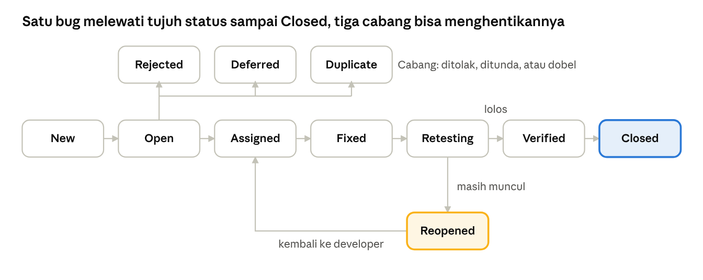
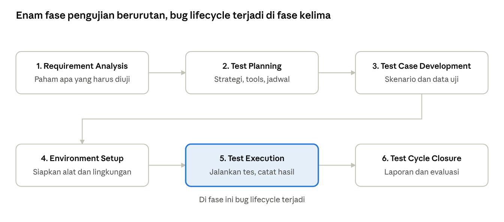

# Catatan QA: Bug Lifecycle dan STLC

Catatan belajar Muhammad Arif Billah Natagama (Minggu 1 roadmap QA).

## 1. Gambaran besar: dua siklus yang saling terkait

Bug lifecycle dan STLC itu dua hal berbeda: **STLC adalah alur kerja seluruh pengujian**, sedangkan **bug lifecycle adalah perjalanan satu bug** dari ditemukan sampai ditutup. Bug lifecycle terjadi di dalam STLC, tepatnya saat fase *Test Execution*.

Analogi renovasi rumah: STLC itu seluruh proyeknya (baca denah, buat rencana, siapkan daftar cek, siapkan alat, periksa tiap ruangan, serah terima). Bug lifecycle itu nasib satu temuan, misalnya "keran bocor": dicatat, diterima tukang, diperbaiki, dicek ulang, lalu dicoret dari daftar.

| | STLC | Bug lifecycle |
|---|---|---|
| Yang dilihat | Seluruh proses pengujian | Satu bug saja |
| Jumlah tahap | 6 fase | 11 status (7 di alur utama, 4 cabang) |
| Mulai dan selesai | Dari paham kebutuhan sampai laporan akhir | Dari New sampai Closed |
| Contoh dari Project 1 | Menguji fitur login SauceDemo dari awal sampai tab Ringkasan Temuan | BUG-01: login tanpa batas percobaan |

## 2. Bug lifecycle: perjalanan satu bug

Satu bug berjalan dari **New** sampai **Closed** lewat tujuh status utama. Di tengah jalan, tiga cabang (Rejected, Deferred, Duplicate) bisa menghentikannya, dan satu cabang (Reopened) mengembalikannya ke developer.

Baca dari kiri ke kanan: New, Open, Assigned, Fixed, Retesting, Verified, lalu Closed. Kalau retest gagal, bug berstatus Reopened dan kembali ke developer.

**Arti tiap status**

| Status | Artinya (bahasa sederhana) | Langkah berikutnya | Contoh dari BUG-01 (login tanpa batas percobaan) |
|---|---|---|---|
| New | Bug baru dilaporkan QA dan belum ditinjau siapa pun. | Ditinjau QA lead atau developer lead. | BUG-01 baru ditulis di bug-reports.md. |
| Open | Sudah ditinjau dan diakui valid, menunggu ditangani. | Diberikan ke developer. | Dinyatakan valid karena membuka risiko brute force. |
| Assigned | Ditugaskan ke developer tertentu. | Developer memperbaiki, lalu status jadi Resolved/Fixed. | Diberikan ke developer bagian autentikasi. |
| Resolved / Fixed | Developer mengaku sudah memperbaiki. | QA menguji ulang. | Developer menambah lockout setelah 5 kali salah (contoh ilustrasi). |
| Retesting | QA mengulang langkah reproduksi yang sama persis seperti saat bug ditemukan. | Lolos jadi Verified, gagal jadi Reopened. | QA login salah 7 kali, lalu cek apakah akun terkunci. |
| Verified | Uji ulang lolos, bug terbukti hilang. | Ditutup. | Setelah 5 kali salah, muncul pesan akun terkunci. |
| Closed | Selesai, tidak ada tindak lanjut. | Tidak ada. | BUG-01 ditutup. |
| Reopened | Setelah retest, bug masih muncul. | Kembali ke developer untuk diperbaiki ulang. | Login ke-7 masih lolos tanpa lockout, bug dibuka lagi. |
| Rejected | Dinilai bukan bug, misalnya memang sesuai desain. | Ditutup dengan alasan penolakan. | OBS-02 bisa dianggap sesuai desain. |
| Deferred | Bug valid tapi perbaikannya ditunda ke rilis berikutnya, biasanya karena prioritas rendah. | Dijadwalkan ulang. | BUG-03 (severity Low) bisa ditunda. |
| Duplicate | Bug yang sama sudah pernah dilaporkan. | Ditutup dan ditautkan ke laporan asli. | Ada QA lain yang sudah melaporkan BUG-02 lebih dulu (contoh ilustrasi). |

Cabang **Rejected, Deferred, dan Duplicate** muncul di awal (setelah New atau Open). Hanya **Reopened** yang muncul setelah retest.

## 3. STLC: alur pengujian dari awal sampai akhir

STLC (Software Testing Life Cycle) adalah **enam fase pengujian yang berjalan berurutan**. STLC berdampingan dengan proses pengembangan aplikasi (SDLC) dan fokus hanya pada urusan pengujian: fase pertama dimulai saat dokumen kebutuhan sudah ada, bukan sejak baris kode pertama.

Baca dari kiri ke kanan di baris atas, lalu lanjut ke baris bawah. Fase 5 (Test Execution) disorot karena di situlah bug ditemukan dan masuk ke bug lifecycle.

**Arti tiap fase**

| Fase | Tujuan | Yang QA lakukan | Hasilnya | Contoh di Project 1 (login SauceDemo) |
|---|---|---|---|---|
| 1. Requirement Analysis | Paham apa yang harus diuji, baik fungsional maupun non-fungsional. | Membaca dokumen kebutuhan, mencari bagian yang belum jelas, lalu bertanya ke analis atau developer. | Daftar hal yang bisa diuji. | Memahami aturan login: kredensial valid dan salah, akun locked_out_user, akses langsung ke halaman. |
| 2. Test Planning | Menentukan strategi, ruang lingkup, tools, dan jadwal. | Menyusun rencana tes. | Dokumen rencana tes. | Ruang lingkup: fitur login, manual testing, Chrome. |
| 3. Test Case Development | Membuat skenario dan data uji yang bisa diulang orang lain. | Menulis test case (ID, prasyarat, data uji, langkah, hasil diharapkan) memakai EP dan BVA. | Kumpulan test case. | TC_LOG_001 sampai TC_LOG_012. |
| 4. Environment Setup | Menyiapkan alat dan lingkungan, ibarat menyiapkan medan sebelum berperang. | Menyiapkan perangkat, browser, akun uji, dan data, lalu cek singkat (smoke test) bahwa aplikasi jalan. | Lingkungan siap pakai. | Chrome 156, Windows 11, akun demo SauceDemo. |
| 5. Test Execution | Menjalankan tes dan mencatat hasilnya. | Menjalankan test case, mengisi Hasil Aktual dan Status, melaporkan bug (di sinilah bug lifecycle dimulai). | Hasil eksekusi dan bug report. | Kolom Hasil Aktual dan Status, plus BUG-01 sampai BUG-03. |
| 6. Test Cycle Closure | Menutup siklus dan mengevaluasi. | Menganalisis hasil, membuat laporan akhir, mencatat pelajaran untuk siklus berikutnya. | Laporan ringkasan. | Tab Ringkasan Temuan: 9 Pass, 2 Fail, 1 N/A. |

## 4. Contoh nyata: dari requirement ke test case

Kualitas test case bergantung pada seberapa paham QA terhadap aturan (requirement) di fase 1. Contoh di bawah adalah aturan rekaan untuk latihan, **bukan aturan SauceDemo**.

**Aturan:** password wajib 8 sampai 20 karakter dan mengandung minimal 1 simbol.

Aturan itu diubah jadi skenario uji memakai dua teknik: **BVA** (uji di batas angka) dan **EP** (uji satu wakil dari tiap kelompok data).

| Skenario | Data uji | Hasil diharapkan | Teknik |
|---|---|---|---|
| Tepat di bawah batas bawah | 7 karakter, ada simbol | Ditolak | BVA |
| Tepat di batas bawah | 8 karakter, ada simbol | Diterima | BVA |
| Tepat di batas atas | 20 karakter, ada simbol | Diterima | BVA |
| Tepat di atas batas atas | 21 karakter, ada simbol | Ditolak | BVA |
| Kelompok tanpa simbol | 12 karakter, tanpa simbol | Ditolak | EP |
| Kelompok valid | 12 karakter, ada simbol | Diterima | EP |
| Kelompok kosong | Dikosongkan | Ditolak, muncul pesan wajib diisi | EP |

**Kalau aturannya tidak jelas, QA bertanya**, bukan menebak. Contoh pertanyaan: password maksimal berapa karakter? Apakah spasi boleh? Simbol apa saja yang dihitung? Pertanyaan seperti ini sering menemukan masalah sebelum aplikasinya selesai dibuat. Di SauceDemo tidak ada dokumen aturan, jadi aturannya ditebak lewat percobaan, lalu dicatat sebagai temuan dan observasi.

**Istilah penting dan artinya**

| Istilah | Artinya | Contoh |
|---|---|---|
| Severity | Seberapa parah dampak bug. | BUG-01 (brute force) = Medium. |
| Priority | Seberapa cepat bug harus diperbaiki. | Typo di logo perusahaan: severity Low tapi priority High, karena semua orang melihatnya. |
| Retesting | Menguji ulang bug yang sama setelah diperbaiki. | Login salah 7 kali lagi untuk cek lockout. |
| Regression | Perbaikan atau perubahan malah merusak fitur lain yang tadinya normal. | Setelah lockout ditambah, login normal jadi gagal. |
| Smoke test | Cek singkat bahwa aplikasi dasar berjalan sebelum pengujian utama. | Halaman login bisa dibuka dan tombol Login bisa diklik. |
| Triage | Menilai bug baru: valid atau tidak, seberapa penting, siapa yang menangani. | Saat bug dari New menjadi Open. |

## 5. Ringkasan 1 menit dan jawaban wawancara

**Versi singkat untuk diingat:** STLC adalah enam fase pengujian (paham kebutuhan, rencana, tulis test case, siapkan lingkungan, jalankan tes, tutup dan evaluasi). Saat fase menjalankan tes, setiap bug yang ditemukan mengikuti bug lifecycle: New, Open, Assigned, Fixed, Retesting, Verified, lalu Closed, dengan cabang Rejected, Deferred, Duplicate, dan Reopened.

**Pertanyaan yang sering muncul dan jawaban singkatnya**

| Pertanyaan | Jawaban singkat |
|---|---|
| Apa itu STLC? | Enam fase pengujian berurutan, dari menganalisis kebutuhan sampai menutup siklus dengan laporan dan evaluasi. |
| Apa itu bug lifecycle? | Perjalanan satu bug dari ditemukan sampai ditutup, dengan status New, Open, Assigned, Fixed, Retesting, Verified, dan Closed. |
| Apa bedanya STLC dan bug lifecycle? | STLC adalah alur seluruh pengujian. Bug lifecycle adalah alur satu bug dan terjadi di dalam fase Test Execution. |
| Apa bedanya severity dan priority? | Severity adalah tingkat keparahan dampak bug. Priority adalah urutan kapan bug harus diperbaiki. |
| Apa itu Reopened? | Status saat retest gagal: bug masih muncul, jadi dikembalikan ke developer. |
| Kapan sebuah bug berstatus Deferred? | Saat bug valid tapi prioritasnya rendah, sehingga perbaikannya dijadwalkan di rilis berikutnya. |
| Apa bedanya retesting dan regression testing? | Retesting menguji ulang bug yang sama. Regression testing memastikan perbaikan itu tidak merusak fitur lain. |
| Apa yang kamu lakukan kalau requirement tidak jelas? | Bertanya ke analis atau developer sebelum menulis test case, supaya tidak menebak. |
